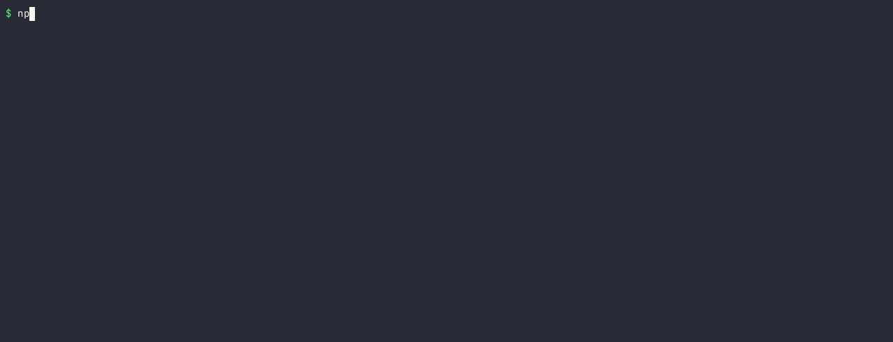
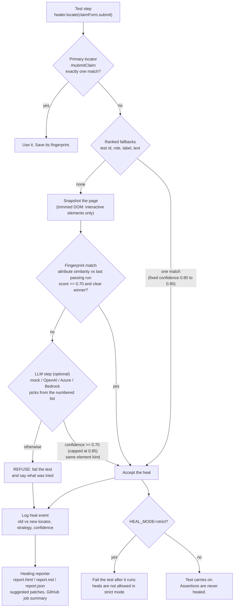
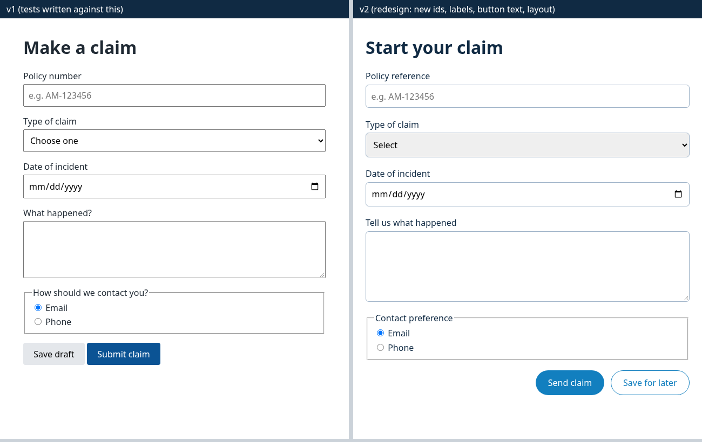
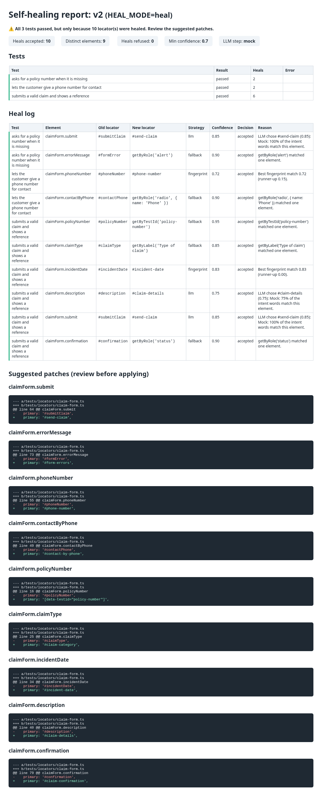
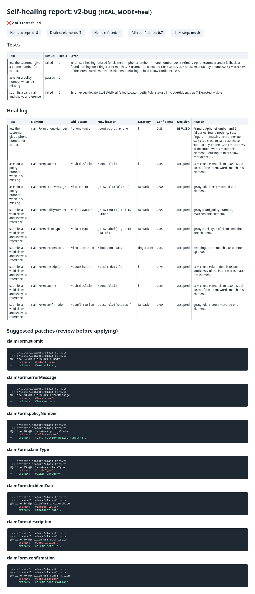

# self-healing-playwright

[](https://github.com/karthickpearl1/self-healing-playwright/actions/workflows/ci.yml)
[](LICENSE)

Self-healing locators for Playwright, built with guardrails. When a locator breaks after a UI change, the suite tries ranked fallbacks, then fingerprints of the element from a passing run, then (optionally) an LLM. Every heal is logged with a confidence score and the old and new locator. A report suggests code patches for a person to review. Low-confidence heals fail the test, and CI can run in strict mode where any heal fails.

This is a personal project. I built it to work through a question I get asked a lot as a test automation engineer: _"should we use self-healing tests?"_ My answer is "yes, but only if healing can never hide a real bug". This repo is my attempt to show what that looks like in code.



## The problem

UI tests break for two very different reasons:

1. **The UI changed but still works.** An id was renamed, a button moved, a label was reworded. The test is wrong, not the app. This is the maintenance tax that makes teams give up on UI automation.
2. **The app is broken.** A button no longer does anything, or a field disappeared. The test is right to fail.

Self-healing tools aim at (1). The danger is that they also "fix" (2) by quietly pointing the test at some other element, so the run goes green and the bug ships. In a regulated business, a green run that hides a broken claims form is worse than a red run.

So the goal here is not "make tests pass". It is: **heal the first kind of failure, always surface the second, and never heal silently.**

## How it works



Key points:

- **Healing only finds elements. It never touches assertions.** If the healed button does not work, `expect(confirmation).toBeVisible()` still fails.
- **The LLM never writes a selector.** It is shown a numbered list of elements that really exist and picks one (or none). Its confidence is capped below the author-written fallbacks.
- **Confidence below 0.70 fails the test.** So does an ambiguous fingerprint match, or an LLM pick of a different element kind (a `<select>` for a `<div>`, say).
- **Strict mode** (`HEAL_MODE=strict`) still heals, so the report can suggest a fix, but fails every test that needed a heal. That is how I would run it on main.

## The demo app

`demo-app/` is a small fictional insurance claim form (no real company), served by a tiny Node server with no dependencies. There are three versions:

| Version  | What changed                                                                                                                                                                        |
| -------- | ----------------------------------------------------------------------------------------------------------------------------------------------------------------------------------- |
| `v1`     | What the tests were written against.                                                                                                                                                |
| `v2`     | A "redesign": renamed ids and classes, reworded labels and headings, the submit button renamed to "Send claim" and moved, test ids removed from most fields. Behaviour is the same. |
| `v2-bug` | v2 plus two **genuine** bugs: the submit script still looks up an old id and crashes, so the claim is never submitted; and the mobile number field was deleted.                     |



`diff demo-app/v1/index.html demo-app/v2/index.html` shows exactly what the healer has to cope with.

## Quick start

Needs Node 20.19+ (I use Node 24, as CI does).

```bash
git clone https://github.com/karthickpearl1/self-healing-playwright.git
cd self-healing-playwright
npm ci
npx playwright install chromium

npm run test:unit   # scoring, LLM parsing, patches, report (no browser)
npm run verify      # runs every scenario below and checks each ended the way it should
```

Reports land in `healing-report/<variant>-<mode>/report.html`.

| Command                              | Scenario                                           |
| ------------------------------------ | -------------------------------------------------- |
| `npm run test:v1`                    | v1 with healing on                                 |
| `npm run test:v1:strict`             | v1 in strict mode (the CI policy)                  |
| `npm run test:v2:naive`              | v2 with healing off: plain Playwright              |
| `npm run test:v2`                    | v2 with healing on                                 |
| `npm run test:v2:strict`             | v2 in strict mode                                  |
| `npm run test:v2-bug`                | v2-bug with healing on                             |
| `npm run fingerprints`               | re-record `fingerprints/fingerprints.json` from v1 |
| `npm run app`                        | serve the demo app on http://localhost:4173/v1/    |
| `npm run lint` / `npm run typecheck` | ESLint + Prettier / TypeScript                     |

## Real results

These are from my runs on Node 24.22.1 and Playwright 1.64.1 (Chromium), with the offline mock LLM. The same suite of 3 tests runs in every scenario. `npm run verify` checks all of this automatically (15 checks, all passing).

| Scenario                | Result                                                            | Heals                                            |
| ----------------------- | ----------------------------------------------------------------- | ------------------------------------------------ |
| v1, healing on          | 3 passed (1.0s)                                                   | 0                                                |
| v1, strict              | 3 passed                                                          | 0                                                |
| v2, healing off (naive) | **3 failed**                                                      | n/a                                              |
| v2, healing on          | 3 passed (10.0s)                                                  | **10 accepted** (9 distinct elements), 0 refused |
| v2, strict              | **3 failed**, each flagged "heals are not allowed in strict mode" | 10 accepted                                      |
| v2-bug, healing on      | **2 failed**, 1 passed                                            | 8 accepted, 1 refused                            |

The 10 heals on v2, from `healing-report/v2-heal/report.md`:

| Element           | Old locator     | New locator                             | Strategy           | Confidence              |
| ----------------- | --------------- | --------------------------------------- | ------------------ | ----------------------- |
| policyNumber      | `#policyNumber` | `getByTestId('policy-number')`          | fallback (test id) | 0.95                    |
| contactByPhone    | `#contactPhone` | `getByRole('radio', { name: 'Phone' })` | fallback (role)    | 0.90                    |
| errorMessage      | `#formError`    | `getByRole('alert')`                    | fallback (role)    | 0.90                    |
| confirmation      | `#confirmation` | `getByRole('status')`                   | fallback (role)    | 0.90                    |
| claimType         | `#claimType`    | `getByLabel('Type of claim')`           | fallback (label)   | 0.85                    |
| incidentDate      | `#incidentDate` | `#incident-date`                        | fingerprint        | 0.83                    |
| phoneNumber       | `#phoneNumber`  | `#phone-number`                         | fingerprint        | 0.72                    |
| submit (×2 tests) | `#submitClaim`  | `#send-claim`                           | LLM (mock)         | 0.85 (capped from 1.00) |
| description       | `#description`  | `#claim-details`                        | LLM (mock)         | 0.75                    |

And the part that matters most, v2-bug:

- **"submits a valid claim"** failed with `expect(locator).toBeVisible() failed`. The submit button and confirmation message were both healed correctly, but the confirmation never appears because the button is broken. Healing found the elements; the assertion caught the bug.
- **"phone number for contact"** failed with `Self-healing refused for claimForm.phoneNumber`. The field was deleted. The best fingerprint match scored 0.15, and the mock LLM's best pick was the "Phone" radio button at 0.33. Both are well under 0.70, so the healer refused rather than typing a phone number into a radio button.
- **"asks for a policy number"** passed, correctly: that part of the form still works.

Two more things I measured:

- **Healing is slow on purpose.** The v2 healing run took 10.0s against 1.0s for v1, because each heal first waits 1.5s for the primary locator. That cost is a feature: a suite that heals a lot gets noticeably slower, which is one more nudge to apply the patches.
- **The mock LLM on its own is not enough.** With fingerprints switched off (`HEAL_FINGERPRINTS=off`) the mock still found the right phone field, but only at 0.67, so the healer refused it and 1 of 3 tests failed. I think that is the right outcome: the gate held, even though the guess was correct.

## The healing report

Every run writes `report.html`, `report.md` and `report.json`. The Markdown version is also added to the GitHub Actions job summary, and the folder is uploaded as a build artifact.

It shows every test, every heal attempt (accepted or refused, with the reason), and a suggested patch to the locator map for each healed element. Patches are suggestions only. Nothing edits the test code automatically.

| v2: every heal accepted, 9 suggested patches         | v2-bug: one refused heal, one real assertion failure         |
| ---------------------------------------------------- | ------------------------------------------------------------ |
|  |  |

A suggested patch looks like this:

```diff
--- a/tests/locators/claim-form.ts
+++ b/tests/locators/claim-form.ts
@@ line 64 @@ claimForm.submit
-    primary: '#submitClaim',
+    primary: '#send-claim',
```

## CI

`.github/workflows/ci.yml` (all actions on their current Node 24 majors):

1. **lint**: ESLint, Prettier, TypeScript type check.
2. **tests**:
   - unit tests of the scoring, LLM parsing, patch and report logic
   - **strict gate on v1**: the tests must pass with zero heals on the app they were written for. This is the policy I would actually enforce.
   - **healing self-test** (`npm run verify`): v2 naive must fail, v2 healing must pass with heals logged and none refused, v2 strict must fail, and v2-bug must fail on its two genuine bugs. If healing ever starts hiding a bug, this step goes red.
   - every report goes to the job summary and the `healing-report` artifact; Playwright traces of failed tests go to `playwright-traces`.

CI uses the offline mock LLM, so it needs no keys and gives the same answer every run.

`.github/workflows/real-llm.yml` is a manual workflow that runs the healing suite with a real model. It switches fingerprints off so every hard case goes to the LLM.

## Using a real LLM

The LLM step calls the provider's HTTP API with `fetch`, so there is no SDK to install (except for Bedrock, which needs AWS request signing).

| Provider                  | Settings                                                                                                        |
| ------------------------- | --------------------------------------------------------------------------------------------------------------- |
| `HEAL_LLM=mock` (default) | none                                                                                                            |
| `HEAL_LLM=openai`         | `OPENAI_API_KEY`, optional `HEAL_LLM_MODEL` (default `gpt-4.1-mini`)                                            |
| `HEAL_LLM=azure`          | `AZURE_OPENAI_ENDPOINT`, `AZURE_OPENAI_API_KEY`, `AZURE_OPENAI_DEPLOYMENT`, optional `AZURE_OPENAI_API_VERSION` |
| `HEAL_LLM=bedrock`        | `npm install @aws-sdk/client-bedrock-runtime`, AWS credentials, `AWS_REGION`, `BEDROCK_MODEL_ID`                |
| `HEAL_LLM=off`            | no LLM step at all                                                                                              |

```bash
export HEAL_LLM=openai OPENAI_API_KEY=...
HEAL_FINGERPRINTS=off npm run test:v2
```

For the manual workflow, add the matching repository secrets (`OPENAI_API_KEY`, or `AZURE_OPENAI_ENDPOINT` + `AZURE_OPENAI_API_KEY`, or `AWS_ROLE_ARN`) and variables (`HEAL_LLM_MODEL`, `AZURE_OPENAI_DEPLOYMENT`, `BEDROCK_MODEL_ID`, `AWS_REGION`).

I have not published real-LLM numbers here. The CI results above are all from the mock, and I would rather show nothing than a figure I cannot reproduce for you.

## Risks of self-healing, and the guardrails here

This is the part I would want a QE lead to read. Self-healing moves a decision ("is this the same element?") from a person to a tool. These are the risks I see, and what this repo does about each.

| Risk                                                                                                   | Guardrail in this repo                                                                                                                                                                                                                                                                                                                                                                   |
| ------------------------------------------------------------------------------------------------------ | ---------------------------------------------------------------------------------------------------------------------------------------------------------------------------------------------------------------------------------------------------------------------------------------------------------------------------------------------------------------------------------------- |
| **Masking real bugs.** The tool heals onto the wrong element and the test passes.                      | Assertions are never healed. Heals need confidence ≥ 0.70. Ambiguous fingerprint matches are refused. The LLM must pick the same kind of element. The `v2-bug` self-test proves a broken button and a deleted field both still fail.                                                                                                                                                     |
| **Silent drift.** Tests keep "passing" for months on healed locators nobody looked at.                 | Every heal is logged, printed in the console, annotated on the Playwright test, and summarised in the report and the CI job summary. A run that only passed because of heals is shown with a ⚠️, never a ✅.                                                                                                                                                                             |
| **Healing becomes the process.** Nobody fixes the locators because the tool copes.                     | Strict mode fails any test that needed a heal. Suggested patches make the real fix a two-minute review. Heals also cost 1.5s each, so a heavily healed suite is visibly slower.                                                                                                                                                                                                          |
| **Trusting an LLM.** It can be confidently wrong, invent selectors, or change its answer between runs. | It only chooses from real elements. Its answer is parsed strictly and anything malformed counts as "no answer". Its confidence is capped at 0.85, below a test id or role. CI uses a deterministic mock. Real models run at temperature 0, in a separate manual workflow.                                                                                                                |
| **Data leaving the building.** Page content is sent to a third-party model.                            | Only a trimmed list of interactive elements (tag, id, name, label, short text) is sent, never the full DOM, cookies or screenshots. The LLM step is off unless a provider is configured, and `HEAL_LLM=off` removes it entirely. For a real insurer I would only use a company-approved endpoint (e.g. Azure OpenAI or Bedrock in-tenant) and I would check what test data is on screen. |
| **Auditability.** "Why did the test pass?" needs an answer.                                            | `report.json` keeps every decision with its reason, and the stored fingerprints are a committed file you can review in a pull request.                                                                                                                                                                                                                                                   |

My overall view: self-healing is useful in the inner loop and on long-running regression packs, to keep feedback flowing while a UI change is fixed properly. It should never be what makes main green. That is why CI here runs strict mode on the current app and only uses healing to _explain_ failures and propose the fix.

## Design decisions

- **TypeScript Playwright, not Python.** Playwright's own test runner (fixtures, projects, custom reporters, annotations) only exists in the Node/TypeScript version, and this project leans on all four. The Python version runs through pytest instead. TypeScript is also what most Playwright job adverts ask for. The code sticks to plain functions and one small class.
- **A locator map, not locators scattered through tests.** `tests/locators/claim-form.ts` holds every element with its primary locator, ranked fallbacks and a plain-English intent. That gives patches one place to land and gives the LLM a description to work from.
- **Fixed confidence for fallbacks.** A test-id match is worth 0.95, role 0.90, label 0.85, text 0.80. These are judgement calls, kept in one file (`src/healing/config.ts`) so they can be challenged.
- **Fingerprint scoring is weighted word overlap.** `policyNumber`, `policy-number` and "Policy number" are treated as the same words. Attributes that survive redesigns (id, name) weigh more than ones that churn (classes). A different tag scores zero. The maths fits on one screen and has unit tests.
- **The LLM picks, it does not write.** Asking a model to write a CSS selector invites made-up selectors. Asking it to choose from a numbered list of real elements removes that failure mode and makes its answer easy to validate.
- **Hidden elements count when healing.** A confirmation message is hidden until the form is submitted. If the healer ignored hidden elements, a broken submit button would show up as a "healing refused" error instead of the honest "confirmation never became visible". Visibility is for assertions to judge.
- **No retries.** `retries: 0` in the config. Retries and healing together make it very hard to know why something passed.
- **Fingerprints are a committed file.** Re-recording them is a deliberate command (`npm run fingerprints`) on a version you trust, and the change shows up in review.

## Limitations

- **The demo is small.** One page, nine elements, three tests. Real apps have repeated components (tables, lists of cards), iframes and shadow DOM, which make "the same element" much harder to decide. I have not tackled those.
- **The mock LLM is not intelligent.** It counts how many words of the element's intent appear in each candidate. It is there so the LLM path (prompt, answer parsing, confidence cap, refusal, report) is tested offline. It does not show how good a real model would be.
- **The thresholds are tuned on this demo.** 0.70 works here. On a real suite I would collect heal logs for a few weeks and set thresholds from the false-heal rate, per risk area.
- **The fingerprint is one snapshot.** It does not learn across many passing runs, and it does not use the element's position in the page.
- **Patch suggestions are basic.** They swap the primary CSS selector. A better suggestion would often be a role-based locator, which I leave to the reviewer.
- **I have only run it with Chromium.**

## Project layout

```text
demo-app/              the claim form: v1, v2 (redesign), v2-bug (genuine bugs) + tiny server
src/healing/
  config.ts            every threshold and the HEAL_MODE switch
  types.ts             data shapes
  healer.ts            the healing locator layer (primary -> fallbacks -> fingerprint -> LLM)
  similarity.ts        fingerprint scoring (pure functions)
  browser.ts           reads element attributes in the page, builds the trimmed snapshot
  llm.ts               prompt, strict answer parsing, mock + OpenAI/Azure/Bedrock
  fingerprints.ts      load/save fingerprints/fingerprints.json
  patch.ts             turns heals into suggested diffs
  fixture.ts           Playwright fixture: attaches heal logs, enforces strict mode
src/reporter/          the custom Playwright reporter and the HTML/Markdown report
tests/e2e/             the claim form tests
tests/locators/        the locator map (where patches apply)
tests/unit/            unit tests of the scoring, LLM, patch and report logic
fingerprints/          stored fingerprints from a passing v1 run
scripts/               scenario runner, verify self-test, demo recording script
docs/                  demo GIF/cast and screenshots
```

## How this relates to my other repos

- [llm-eval-harness](https://github.com/karthickpearl1/llm-eval-harness): evaluating LLM outputs as a test problem.
- This repo goes the other way: using an LLM _inside_ a test framework, and putting test-engineering guardrails around it.

## Licence

MIT, see [LICENSE](LICENSE).
